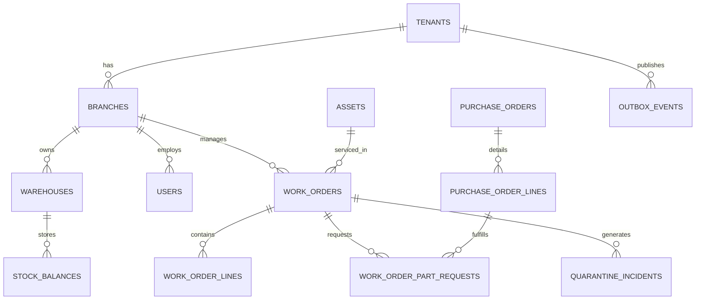
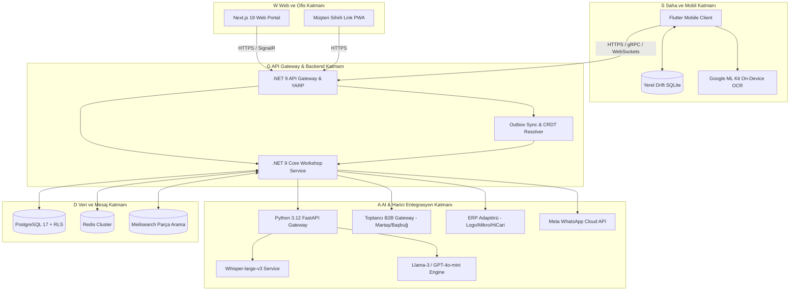
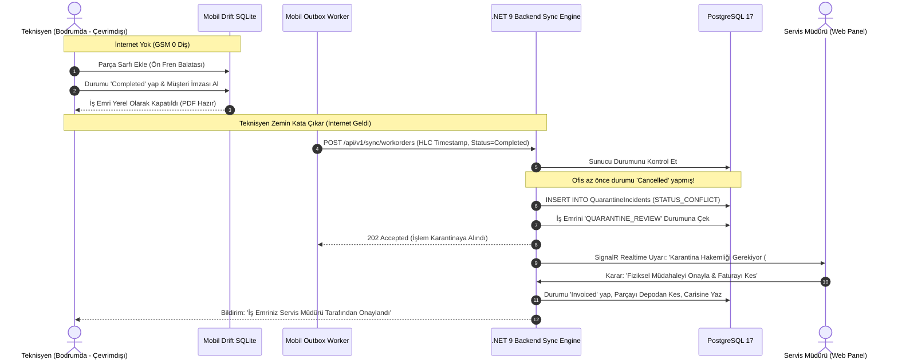
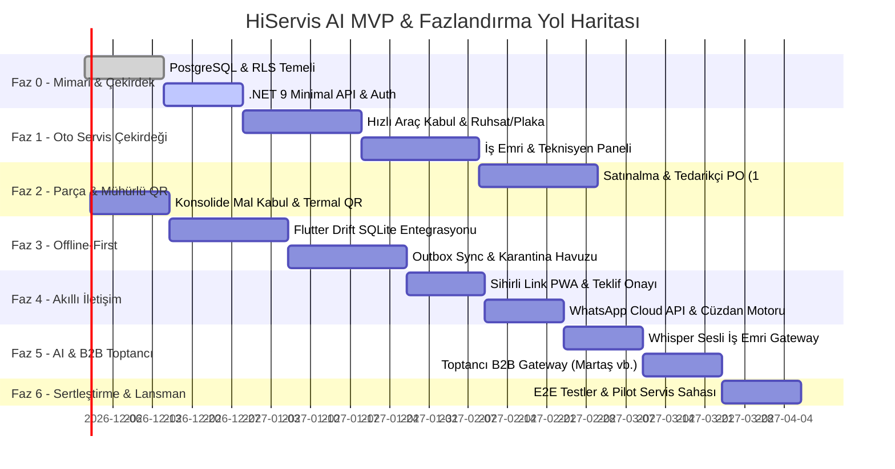

# HiServis AI — Proje Anayasası (Master Blueprint v1.1)

**Sürüm:** 1.1 (Production-Ready)  
**Tarih:** 18 Kasım 2026  
**Roller:** Lead Architect & CPO (Kurucu Ortaklar)  
**Hedef Sektör:** Bağımsız Özel Oto Servisleri & Filo Bakım Yönetimi (MVP)  
**Teknoloji Yığını:** .NET 9 Web API + PostgreSQL 17 + Flutter (Drift SQLite) + Next.js 19 + Python 3.12 (LangGraph / FastAPI)

---

## 1. YÖNETİCİ ÖZETİ VE ÇEKİRDEK İLKELER (CORE TENETS)

HiServis AI; Türkiye pazarındaki statik formlu, internet kesildiğinde kilitlenen ve parçayı araca bağlayamayan eski nesil servis yazılımlarının (FieldCo vb.) yerine geliştirilen; **Offline-First**, **Kapalı Devre Parça İzlenebilirliği** ve **Pragmatik Yapay Zeka Otomasyonu** sunan yeni nesil bir B2B SaaS platformudur.

### Kurucu Ortak İlkelerimiz (Anayasa Maddeleri)
1. **Sıfır Sahipsiz Parça:** Sanayi sitesinde depoya giren her kutu, araç ve iş emri ile anında mühürlenir. Atölyede etiketsiz, sahipsiz kutu ve yanlış montaj barınamaz.
2. **Sahada Sıfır Kesinti (Offline-First Guarantee):** Bodrum katında veya çekmeyen lifte teknisyen hiçbir engele takılmaz; yerel SQLite üzerinde iş emri açar, parça düşer, ses kaydeder ve imza alır.
3. **Sessiz Karantina (Silent Quarantine over Silent Overwrite):** Çevrimdışı ve çevrimiçi durum çakışmalarında sistem asla "Son Yazılan Kazanır" körlüğüyle veriyi ezmez. Veri karantinaya alınır ve servis müdürünün onayına sunulur.
4. **Birim Ekonomi Disiplini (Margin Protection):** WhatsApp Business API gibi döviz bazlı dış bağımlılıklar, Sihirli Link (PWA Web Takip) ve Cüzdan modeli ile korunur; yazılım sattıkça zarar etmez.
5. **Önce Dikeyde Mükemmellik:** 16 sektöre birden vasat hizmet vermek yerine; ilk sürümde Türkiye Özel Oto Servis & Filo pazarında mutlak liderlik kurulacak, çekirdek motor esnek tutularak diğer dikeyler sonraki fazlarda açılacaktır.

---

## 2. ÜRÜN GEREKSİNİM DOKÜMANI (PRD v1.1)

### 2.1 Kullanıcı Rolleri ve Erişim Matrisi

| Rol | Platform | Temel Sorumluluk | Kritik Yetkiler |
|---|---|---|---|
| **Servis Sahibi (Patron)** | Web / Mobil | Şirket kârlılığı, ciro, şube denetimi | Tüm şubeler, finansal raporlar, cüzdan yükleme |
| **Servis Müdürü / Danışmanı** | Web (Next.js) | Araç kabul, teklif, iş emri koordinasyonu, faturalama | Karantina çözümü, teklif onaylama, ERP aktarımı |
| **Saha / Atölye Teknisyeni** | Mobil (Flutter) | Arıza tespiti, parça sarfı, montaj, sesli iş emri | İş emri başlatma/tamamlama, yerel parça düşümü |
| **Depo / Satınalma Sorumlusu** | Mobil / Web | Toptancı mal kabulü, iç QR basımı, stok transferi | PO oluşturma, barkod eşleştirme, van-stock transferi |
| **Ön Muhasebe** | Web (Next.js) | Fatura kesimi, tahsilat, cari mutabakatı | ERP faturası basma, kasa/POS kapama, açık hesap takibi |
| **Araç Sahibi (Müşteri)** | PWA (Sihirli Link) | Canlı durum takibi, ek parça onayı, ödeme | Teklif onay/red, fotoğraf görüntüleme, sanal POS |

---

### 2.2 Uçtan Uca Temel Kullanıcı Senaryoları (User Journeys)

#### Senaryo A: 30 Saniyenin Altında Hızlı Araç Kabul
```
[Araç Servise Girer] 
       │
       ▼
[Kamera ile Plaka Okuma (On-Device OCR)] ──► Sistemde Kayıtlı mı?
       │                                            │
       ├─────────────── EVET ───────────────────────┤
       │                                            ▼
       │                             [Tüm Geçmiş Ekranda]
       │                             (Eski Değişenler, Borç, KM Tahmini)
       ▼ HAYIR
[Ruhsat Fotoğrafı Çekimi]
       │
       ▼
[On-Device / Asenkron OCR] ──► TCKN, Şase No, Motor No Çıkarımı
       │
       ▼
[TSB Kasko Kodu / Araç Kataloğu Eşleştirmesi] ──► Marka, Model, Motor, Paket Otomatik Dolar
       │
       ▼
[KM Girişi + Müşteri Şikayeti + Lifte Sevk]
       │
       ▼
[Müşteriye Otomatik WhatsApp Bildirimi] ──► "Aracınız kabule alındı: hiservis.link/xyz"
```

#### Senaryo B: Konsolide Parça Mal Kabul ve Kapalı Devre Mühürleme
```
[Toptancı Kolisi Gelir (4 Takım Aynı Buji)]
       │
       ▼
[Depocu EAN Barkodunu Okutur]
       │
       ▼
[HiServis Ekranında Açık Talepler Listelenir]
 ├── 1. 34 ABC 123 (Ahmet Usta - Passat - Acil)
 ├── 2. 06 BCD 456 (Mehmet Usta - Megane - Beklemede)
 └── 3. Genel Depo Stoğu
       │
       ▼
[Depocu 'Tahsis Et' Butonuna Basar]
       │
       ▼
[Termal Yazıcıdan 'HiServis Mühürlü QR' Anında Basılır]
 ┌────────────────────────────────────────┐
 │ HiServis MÜHÜRLÜ PARÇA ETİKETİ         │
 │ İş Emri: #WO-9021   Plaka: 34 ABC 123  │
 │ Şase: WVWZZZ3CZWE... Usta: Ahmet Usta  │
 │ Parça: Bosch Fren Balatası [QR KODU]   │
 └────────────────────────────────────────┘
       │
       ▼
[Etiket Kutunun Üzerine Yapıştırılır ──► Doğru Lifte Teslim Edilir]
```

#### Senaryo C: Çevrimdışı Bodrum Katında Sesli İş Emri ve Karantina Senkronizasyonu
1. Teknisyen çukurda/bodrumda internet kesikken Flutter mobil uygulamasında mikrofona basar:
   > *"Sol ön salıncak burcu yırtılmış, çift taraflı değişecek. 5-30 Castrol yağ 4 litre doldurdum. Yağ filtresi takıldı."*
2. Uygulama sesi yerel şifreli dosya olarak saklar ve yerel Drift SQLite'ta parçaları geçici sarfiyat olarak rezerve eder.
3. Teknisyen zemin kata çıkıp internete bağlandığı anda:
   - **Outbox Worker** ses dosyasını sunucuya fırlatır.
   - **Whisper-large-v3 + Llama-3** sesi yapılandırılmış iş emri taslağına dönüştürür.
   - Eğer ofisteki danışman iş emrini iptal etmişse, sistem **Karantina Olayı (Quarantine Incident)** tetikler; parçayı ve işçiliği koruyarak Servis Müdürünün onayına düşürür.

---

### 2.3 Kabul Kriterleri (Acceptance Criteria - Gherkin Formatı)

#### Özellik 1: Mal Kabulde Mühürlü Parça Eşleştirme
```gherkin
Senaryo: Toptancıdan gelen ortak EAN barkodlu parçanın iş emrine tahsis edilmesi
  Diyelim ki sistemde 34 ABC 123 plakalı araç için bekleyen 1 adet "Bosch 0986479" balata talebi var
  Ve toptancı kolisinde "4047024185242" EAN barkodlu ürün depoya ulaştı
  Depo sorumlusu barkodu el terminaliyle okuttuğunda
  Sistem ekranda 34 ABC 123 plakalı iş emrini öncelikli tahsis adayı olarak göstermelidir
  Depocu tahsisi onayladığında
  Sistem Bluetooth/Ağ termal yazıcısından Plaka, Şase ve İş Emri QR kodu içeren mühür etiketini basmalıdır
  Ve ilgili iş emrinin parça durumu "Depoda Hazır" olarak güncellenmelidir.
```

#### Özellik 2: Çevrimdışı Durum Çakışması Karantina Yönetimi
```gherkin
Senaryo: İnternetsiz tamamlanan iş emrinin ofiste iptal edilmiş olması durumunda Karantina tetiklenmesi
  Diyelim ki Teknisyen internet bağlantısı yokken #WO-501 numaralı iş emrine parça ekleyip "Tamamlandı" yaptı
  Ve aynı esnada Ofis Danışmanı web panelinden #WO-501 numaralı iş emrini "Müşteri İptali" yaptı
  Teknisyenin cihazı internete bağlandığında
  Sistem sunucudaki iş emrini otomatik olarak ezmemelidir
  İş emri durumu "QUARANTINE_REVIEW (Karantinada / İnceleme Bekliyor)" durumuna alınmalıdır
  Servis Müdürünün paneline "Fiziksel Müdahale Yapılmış İptal Çakışması" bildirimi düşmelidir
  Ve fiziksel olarak takılan parçanın stok düşümü karantina çözülene kadar askıda tutulmalıdır.
```

---

## 3. VERİTABANI VE VERİ MODELİ ŞEMASI (POSTGRESQL 17 & DRIFT SQLITE)

### 3.1 Varlık İlişki Diyagramı (ERD)



---

### 3.2 PostgreSQL 17 Çekirdek Tablo Tanımları (DDL)

```sql
-- 1. TENANTS & HİYERARŞİ (ÇOK ŞUBELİ YAPI)
CREATE TABLE Tenants (
    Id UUID PRIMARY KEY DEFAULT gen_random_uuid(),
    Name VARCHAR(150) NOT NULL,
    TaxNumber VARCHAR(20) NOT NULL,
    Subdomain VARCHAR(50) UNIQUE NOT NULL,
    SubscriptionTier VARCHAR(30) NOT NULL DEFAULT 'Professional', -- Starter, Pro, Enterprise
    SmsBalance INT NOT NULL DEFAULT 50,
    WhatsAppBalance INT NOT NULL DEFAULT 200,
    CreatedAt TIMESTAMPTZ NOT NULL DEFAULT clock_timestamp()
);

CREATE TABLE Branches (
    Id UUID PRIMARY KEY DEFAULT gen_random_uuid(),
    TenantId UUID NOT NULL REFERENCES Tenants(Id) ON DELETE RESTRICT,
    Name VARCHAR(100) NOT NULL, -- Örn: Maslak Şubesi, Bostancı Şubesi
    City VARCHAR(50) NOT NULL,
    Phone VARCHAR(20),
    IsActive BOOLEAN NOT NULL DEFAULT true,
    CreatedAt TIMESTAMPTZ NOT NULL DEFAULT clock_timestamp()
);

CREATE TABLE Warehouses (
    Id UUID PRIMARY KEY DEFAULT gen_random_uuid(),
    TenantId UUID NOT NULL REFERENCES Tenants(Id) ON DELETE RESTRICT,
    BranchId UUID NOT NULL REFERENCES Branches(Id) ON DELETE RESTRICT,
    Name VARCHAR(100) NOT NULL, -- Örn: Maslak Ana Raf, 34-ABC-01 Gezici Araç (Van Stock)
    WarehouseType VARCHAR(30) NOT NULL DEFAULT 'BranchRack', -- Central, BranchRack, VanStock, Scrap
    AssignedUserId UUID, -- Gezici araç ise zimmetli teknisyen ID
    IsActive BOOLEAN NOT NULL DEFAULT true
);

-- 2. SOYUTLANMIŞ SEKTÖR BAĞIMSIZ VARLIK (OTOMOTİV DERİNLİKLİ ASSET)
CREATE TABLE Assets (
    Id UUID PRIMARY KEY DEFAULT gen_random_uuid(),
    TenantId UUID NOT NULL REFERENCES Tenants(Id),
    PrimaryIdentifier VARCHAR(50) NOT NULL, -- Plaka: '34 ABC 123'
    SecondaryIdentifier VARCHAR(50),      -- Şase / VIN: 'WVWZZZ3CZWE...'
    AssetType VARCHAR(30) NOT NULL DEFAULT 'Automotive', -- Automotive, Machinery vb.
    Brand VARCHAR(60) NOT NULL,           -- Volkswagen
    Model VARCHAR(60) NOT NULL,           -- Passat 1.6 TDI
    ModelYear INT,
    EngineCode VARCHAR(30),
    TsbCode VARCHAR(30),                  -- Türkiye Sigorta Birliği Kasko Araç Kodu
    CurrentMeter INT NOT NULL DEFAULT 0,  -- Güncel KM
    LastServiceDate TIMESTAMPTZ,
    DynamicAttributes JSONB NOT NULL DEFAULT '{}'::jsonb, -- Kaporta hasar haritası, lastik ebatları vb.
    CreatedAt TIMESTAMPTZ NOT NULL DEFAULT clock_timestamp()
);
CREATE INDEX idx_assets_tenant_plate ON Assets (TenantId, PrimaryIdentifier);
CREATE INDEX idx_assets_vin ON Assets (TenantId, SecondaryIdentifier);

-- 3. DÜZELTİLMİŞ SATINALMA VE İŞ EMRİ PARÇA TALEP İLİŞKİSİ (1:N & N:M)
CREATE TABLE PurchaseOrders (
    Id UUID PRIMARY KEY DEFAULT gen_random_uuid(),
    TenantId UUID NOT NULL REFERENCES Tenants(Id),
    BranchId UUID NOT NULL REFERENCES Branches(Id),
    PoNumber VARCHAR(50) NOT NULL, -- PO-2026-0001
    SupplierName VARCHAR(150) NOT NULL, -- Başbuğ Oto, Martaş vb.
    SupplierTaxNo VARCHAR(20),
    Status VARCHAR(30) NOT NULL DEFAULT 'Draft', -- Draft, Ordered, PartialReceived, Completed, Cancelled
    TotalAmount NUMERIC(15,2) NOT NULL DEFAULT 0.00,
    CreatedAt TIMESTAMPTZ NOT NULL DEFAULT clock_timestamp()
);

CREATE TABLE PurchaseOrderLines (
    Id UUID PRIMARY KEY DEFAULT gen_random_uuid(),
    TenantId UUID NOT NULL REFERENCES Tenants(Id),
    PurchaseOrderId UUID NOT NULL REFERENCES PurchaseOrders(Id) ON DELETE CASCADE,
    PartSku VARCHAR(50) NOT NULL,
    OemCode VARCHAR(50),
    PartDescription VARCHAR(200) NOT NULL,
    OrderedQuantity INT NOT NULL,
    ReceivedQuantity INT NOT NULL DEFAULT 0,
    UnitPrice NUMERIC(12,2) NOT NULL,
    Status VARCHAR(30) NOT NULL DEFAULT 'Pending' -- Pending, PartiallyReceived, Received, Cancelled
);

CREATE TABLE WorkOrders (
    Id UUID PRIMARY KEY DEFAULT gen_random_uuid(),
    TenantId UUID NOT NULL REFERENCES Tenants(Id),
    BranchId UUID NOT NULL REFERENCES Branches(Id),
    AssetId UUID NOT NULL REFERENCES Assets(Id),
    WorkOrderNumber VARCHAR(50) NOT NULL, -- WO-2026-10492
    CustomerName VARCHAR(150) NOT NULL,
    CustomerPhone VARCHAR(25) NOT NULL,
    TechnicianUserId UUID,
    Status VARCHAR(30) NOT NULL DEFAULT 'Open', -- Open, InProgress, WaitingParts, Completed, Invoiced, Cancelled, Quarantine
    IntakeMeter INT NOT NULL, -- Giriş KM'si
    CustomerComplaint TEXT,
    InternalNotes TEXT,
    GrandTotal NUMERIC(15,2) NOT NULL DEFAULT 0.00,
    PaidAmount NUMERIC(15,2) NOT NULL DEFAULT 0.00,
    RemainingBalance NUMERIC(15,2) NOT NULL DEFAULT 0.00,
    ErpSyncStatus VARCHAR(30) NOT NULL DEFAULT 'NotSynced', -- NotSynced, Queued, Synced, SyncFailed
    ErpInvoiceNumber VARCHAR(50),
    HlcTimestamp BIGINT NOT NULL, -- Hybrid Logical Clock (Offline Sync için)
    CreatedAt TIMESTAMPTZ NOT NULL DEFAULT clock_timestamp(),
    UpdatedAt TIMESTAMPTZ NOT NULL DEFAULT clock_timestamp()
);

CREATE TABLE WorkOrderPartRequests (
    Id UUID PRIMARY KEY DEFAULT gen_random_uuid(),
    TenantId UUID NOT NULL REFERENCES Tenants(Id),
    WorkOrderId UUID NOT NULL REFERENCES WorkOrders(Id) ON DELETE CASCADE,
    PoLineId UUID REFERENCES PurchaseOrderLines(Id), -- Hangi PO satırından karşılandığı
    PartSku VARCHAR(50) NOT NULL,
    PartName VARCHAR(200) NOT NULL,
    RequestedQuantity INT NOT NULL DEFAULT 1,
    AllocatedQuantity INT NOT NULL DEFAULT 0,
    InternalSealedQr VARCHAR(100), -- Mühürlü Plaka+Şase+İşEmri QR Kodu
    Status VARCHAR(30) NOT NULL DEFAULT 'Pending', -- Pending, Ordered, Allocated, Installed, Returned
    TargetWarehouseId UUID REFERENCES Warehouses(Id)
);

-- 4. KARANTİNA VE ÇAKIŞMA İNCELEME TABLOSU (QUARANTINE QUEUE)
CREATE TABLE QuarantineIncidents (
    Id UUID PRIMARY KEY DEFAULT gen_random_uuid(),
    TenantId UUID NOT NULL REFERENCES Tenants(Id),
    BranchId UUID NOT NULL REFERENCES Branches(Id),
    WorkOrderId UUID NOT NULL REFERENCES WorkOrders(Id),
    ConflictType VARCHAR(50) NOT NULL, -- 'STATUS_CONFLICT_CANCEL_VS_COMPLETE', 'STOCK_DEFICIT'
    ServerState JSONB NOT NULL,
    ClientState JSONB NOT NULL,
    ResolutionStatus VARCHAR(30) NOT NULL DEFAULT 'PendingReview', -- PendingReview, ResolvedByManager, Dismissed
    ResolutionAction VARCHAR(50), -- 'AcceptClientState', 'AcceptServerState', 'ManualCorrection'
    ManagerNotes TEXT,
    ResolvedByUserId UUID,
    ResolvedAt TIMESTAMPTZ,
    CreatedAt TIMESTAMPTZ NOT NULL DEFAULT clock_timestamp()
);

-- 5. ASENKRON OUTBOX TABLOSU (TRANSACTIONAL OUTBOX PATTERN)
CREATE TABLE OutboxEvents (
    Id UUID PRIMARY KEY DEFAULT gen_random_uuid(),
    TenantId UUID NOT NULL REFERENCES Tenants(Id),
    AggregateType VARCHAR(50) NOT NULL, -- 'WorkOrder', 'PurchaseOrder', 'VoiceAudio'
    AggregateId UUID NOT NULL,
    EventType VARCHAR(100) NOT NULL,    -- 'WorkOrderCompletedEvent', 'VoiceTranscriptRequested'
    Payload JSONB NOT NULL,
    RetryCount INT NOT NULL DEFAULT 0,
    ProcessedAt TIMESTAMPTZ,
    ErrorMessage TEXT,
    CreatedAt TIMESTAMPTZ NOT NULL DEFAULT clock_timestamp()
);
CREATE INDEX idx_outbox_unprocessed ON OutboxEvents (ProcessedAt) WHERE ProcessedAt IS NULL;
```

---

## 4. SİSTEM MİMARİSİ VE ENTEGRASYON ŞEMASI

### 4.1 Katmanlı Mimari Topolojisi



---

### 4.2 Çevrimdışı Senkronizasyon ve Karantina Akış Şeması



---

### 4.3 Hibrit ERP Adaptör Mimarisi (Single Source of Truth Kuralı)

* **Servis Operasyonunda HiServis Patron:** İş emrinin açılışı, arıza tespiti, teknisyen işçilik süresi, depodan parça çıkışı ve müşteri kabul fişi taslağında tek gerçek kaynak HiServis'tir.
* **Resmi Muhasebede Harici ERP Patron:** İş emri bittiğinde, arka plandaki `ErpSyncWorker` faturayı ERP'ye iletir. ERP'den dönen resmi `E-Fatura No` ve `UUID` HiServis'e yazılır ve iş emri kalıcı kilitlenir (`IsLocked = true`).
* **Tek Yönlü İptal Yasağı:** ERP'den fatura silindiğinde HiServis iş emrini otomatik silmez; "ERP Faturası İptal Edildi - İnceleme Gerekli" finansal uyarı bayrağı kaldırır.

---

## 5. SINIR DURUMLAR (EDGE CASES) VE ÇÖZÜM PROTOKOLÜ

| # | Sınır Durum (Edge Case) | Operasyonel Risk | Anayasa Çözüm Protokolü |
|---|---|---|---|
| **1** | **Müşteri Borcu Varken Aracı Teslim Alma Talebi** | Servis danışmanı müşteriyi kırmak istemez, nakit yok, açık hesap riski. | **Esnek/Uyarıcı Model:** Danışman aracı teslim edebilir. Sistem kırmızı uyarı rozeti açar, kalan bakiyeyi doğrudan Müşteri Cari Hesabına devreder ve danışmanın kullanıcı ID'sini "Teslim Eden Yetkili" olarak loglar. |
| **2** | **Tedarikçinin Sipariş Edilen Parçayı Eksik Göndermesi** | 4 adet sipariş edilen amortisörden sadece 2 adedinin kargo kolisiyle gelmesi. | **Kısmi Teslimat (Partial PO Receipt):** PO satırı `PartiallyReceived` durumuna geçer. Gelen 2 kutuya anında öncelikli ilk iş emrinin QR etiketi basılır. İkinci iş emri "Eksik Parça Bekleniyor" durumunda kalır. |
| **3** | **Toptancı Parça Kutusunun Yanlış Çıkması (Kutu İçi Uyumsuzluğu)** | Usta lifte kutuyu açtığında parçanın araca uymadığını fark eder. | **Tersine İade Akışı:** Teknisyen mobilde "Uyumsuz Parça" butonuna basar. Sistem parçayı iş emrinden düşer, `ReturnToSupplier` (Tedarikçiye İade) rafına yönlendirir ve yeni parça talebi açar. |
| **4** | **WhatsApp Kota Aşımı ve Müşteri Onayı Tıkanması** | Servisin aylık 200 mesajlık ücretsiz kotası biter, cüzdanda bakiye yoktur. | **Otomatik PWA / SMS Fallback:** WhatsApp gönderilemezse sistem durmaz. Servis danışmanına "Kredi bitti" uyarısı verir ve müşteriye yerel operatör üzerinden anlık SMS ile Sihirli Link gönderilir. |
| **5** | **Gezici Servis Aracında (Van Stock) Parçanın Fiziksel Olarak Tükenmesi** | Yoldaki teknisyen acil akü değişimine gider, bagajda akü kalmamıştır. | **Mobil Acil Talep:** Teknisyen mobilden en yakın şube deposuna veya bölgedeki anlaşmalı toptancıya "Doğrudan Araç Konumuna Sipariş" talebi açar. |

---

## 6. FAZLANDIRILMIŞ TESLİMAT TAKVİMİ (28 HAFTA)



---
*Bu doküman, HiServis AI kurucu ortakları tarafından mutabakatla kabul edilmiş ve geliştirme süreçlerinin değiştirilemez mimari ve stratejik anayasası olarak yürürlüğe girmiştir.*
