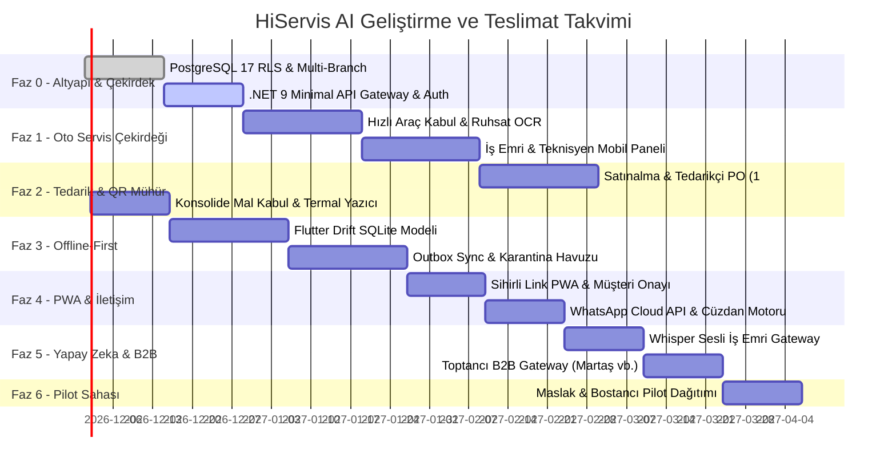

# HiServis AI — Mevcut Durum ve Modüler Yol Haritası

> **Durum:** Canlı Yol Haritası (Live Roadmap)  
> **Sürüm:** v1.1  
> **Planlama Süresi:** 28 Hafta (7 Faz)  
> **Hedef:** Bağımsız Özel Oto Servisleri & Filo Bakım MVP Lansmanı

---

## 1. Teslimat Özeti ve Fazlandırma Matrisi

---

## 2. Faz Bazında Yetenek ve Teslimat Tablosu

| Faz | Hafta | Kapsam | Temel Çıktılar | Doğrulama Kriteri |
|---|---|---|---|---|
| **Faz 0** | H1 – H4 | **Mimari Çekirdek & Çok Şubeli Altyapı** | PostgreSQL 17 DDL, `TenantId` $\rightarrow$ `BranchId` $\rightarrow$ `WarehouseId` RLS politikaları, .NET 9 Minimal APIs, JWT & 4 Haneli PIN kimlik doğrulama. | Çapraz şube sorgusunda 0 satır dönmesi, token güvenliği. |
| **Faz 1** | H5 – H10 | **Hızlı Araç Kabul & İş Emri Motoru** | Mobil Plaka OCR, Ruhsat OCR, TSB Kasko Araç Kataloğu, 2D hasar işaretleme şeması, İş emri durum makinesi, Teknisyen mobil paneli. | Kabul işleminin 30 saniyenin altında tamamlanabilmesi. |
| **Faz 2** | H11 – H15 | **Tedarik Zinciri & Termal Mühürlü Parça** | 1:N `PurchaseOrders` ve `PurchaseOrderLines` tabloları, konsolide koli mal kabul ekranı, el terminali ESC-POS Bluetooth yazıcı entegrasyonu, iç QR mühür basımı. | Toptancıdan gelen ortak EAN'lı 4 bujinin doğru araçlara mühürlenmesi. |
| **Faz 3** | H16 – H21 | **Offline-First & Karantina Çakışma Yönetimi** | Flutter Drift SQLite yerel veritabanı, Outbox Sync Worker, Hybrid Logical Clocks, `QuarantineIncidents` tablosu ve Servis Müdürü Hakemlik Paneli. | Bodrum katında internetsiz tamamlanan iş emrinin web iptaliyle çakışmasında karantina tetiklenmesi. |
| **Faz 4** | H22 – H25 | **Sihirli Link PWA & Akıllı İletişim Cüzdanı** | Müşteri mobil web takip ekranı (PWA), WebSockets canlı durum, usta fotoğrafları, ek parça onay/red arayüzü, Meta WhatsApp Cloud API, 200 mesaj taban kota, ön ödemeli cüzdan motoru. | Müşterinin WhatsApp'tan tek tıkla uygulamayı kurmadan teklifi onaylayabilmesi. |
| **Faz 5** | H26 – H27 | **Yapay Zeka (Whisper) & Toptancı B2B Hub** | Python 3.12 FastAPI mikroservisi, Whisper-large-v3 Türkçe sanayi jargonu ince ayarı (fine-tuning), Llama-3 yapılandırılmış JSON çıkarımı, Martaş ve Başbuğ B2B robotları. | Teknisyenin gürültülü ses kaydından iş emri kalemlerinin %90+ doğrulukla ayrıştırılması. |
| **Faz 6** | H28 | **Pilot Saha Canlıya Alma & Lansman** | Maslak ve Bostancı'daki 2 pilot oto servisinde tam kapsamlı saha testi, son kullanıcı geri bildirimleri, performans optimizasyonu. | 1 hafta boyunca sıfır sahipsiz parça ve sıfır veri kaybı ile servis operasyonunun dönmesi. |
