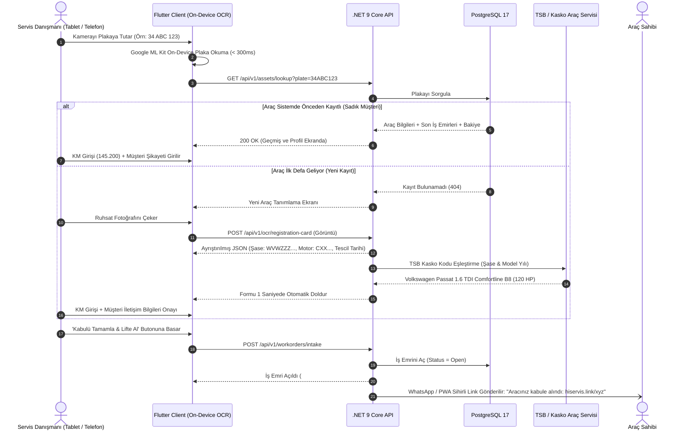

# Modül 1: Hızlı Varlık Kabulü & Sektörel Giriş Motoru (Multi-Industry Asset Intake)

> **Modül Kodu:** MOD-01  
> **Durum:** Canlı Şartname (Active Specification) · Sürüm: v1.2  
> **Sorumlu:** Mobil Ekip (Flutter), Frontend (Next.js) & Backend Ekibi (.NET 10)  
> **İlgili Referanslar:** [PROJE_ANAYASASI.md](../../PROJE_ANAYASASI.md) · [Teknik Mimari](../01-mimari-ve-altyapi/TEKNIK_MIMARI.md) · [Kabul Hızı Testi](../04-test-ve-rehberler/ARAC_KABUL_HIZI_MANUEL_TEST.md)

---

## 1. Modülün Amacı ve Değer Önerisi

Geleneksel servis yazılımları ya yalnızca binek otomobillere göre kilitlenmiş ya da genel sanayiye hitap edemeyecek kadar hantal ve statik formlardan oluşur. Bir teknisyen veya servis danışmanı seri numarasını, şaseyi veya kimlik numarasını elle yazarken sıklıkla harf hatası yapar (`0` ile `O`, `1` ile `I` karışır), bu da parça tedariğinde ve sahada büyük maliyet yaratır.

**Modül 1'in Değer Önerisi:**
* **Hedef Süre:** Bir varlığın (araç, asansör, jeneratör vb.) servise veya bakım planına girişinden istasyona/lifte sevk edilmesine kadar geçen süreyi **30 saniyenin altına** indirmek.
* **Sıfır Yazım Hatası:** Otomotivde Ruhsat/Plaka OCR; Asansörde Bakanlık Kimlik / Karekod taraması; Jeneratör ve makinelerde seri no barkod taraması.
* **Agnostik Sektörel Esneklik:** Tek bir tıklama veya şube profili ile formların sektöre göre dinamik olarak şekillenmesi (Plaka $\leftrightarrow$ Bina/UAVT $\leftrightarrow$ Seri No; KM $\leftrightarrow$ Seyir/Kat $\leftrightarrow$ Çalışma Saati).

---

## 1.1 Sektörel Giriş Parametreleri Eşleşmesi

| Sektör | Birincil Kimlik Alanı | İkincil Kimlik Alanı | Sayaç / Metrik | Muayene / DVI Formatı | Hızlı Giriş Yöntemi |
| :--- | :--- | :--- | :--- | :--- | :--- |
| **Oto Servis & Filo** | Plaka (`34 ABC 123`) | Şase / VIN | Kilometre (km) | 2D Kaporta Hasar & Mekanik DVI | Kamera Plaka & Ruhsat OCR |
| **Asansör & Yürüyen Merdiven** | Bakanlık Kimlik / UAVT No | Seri No / Ruhsat No | Seyir Sayısı / Kat Adedi | A-Tipi Muayene (Kırmızı/Sarı/Yeşil) | Karekod / Barkod Okuma |
| **Jeneratör & Kompresör** | Şasi Seri No | Motor / Alternatör No | Çalışma Saati (Hourmeter) | Akü / Yağ / Yük Testi | Seri No Barkod / QR |
| **İklimlendirme (HVAC)** | Ünite Seri No | Lokasyon / Mahalli ID | Gaz Tipi & Basınç (Bar) | Gaz Kaçak & Elektrik Amperajı | Cihaz Etiketi OCR / Karekod |
| **Endüstriyel Makine** | Demirbaş No | Model / İmalat Yılı | Mil Çalışma Saati / Devir | Titreşim & Kalibrasyon Kartı | Makine Plakası Barkod |

---

## 2. Uçtan Uca İş Akışı (Flow Diagram)



---

## 3. Veri Sözleşmesi (Data Contracts)

### 3.1 Ruhsat OCR Çıktı Modeli (`RegistrationCardOcrResult`)
```json
{
  "plateNumber": "34ABC123",
  "vin": "WVWZZZ3CZWE123456",
  "engineNumber": "CXX123456",
  "brand": "VOLKSWAGEN",
  "modelYear": 2018,
  "color": "BEYAZ",
  "documentSerial": "AA123456",
  "firstRegistrationDate": "2018-05-14T00:00:00Z",
  "confidenceScore": 0.96,
  "tsbVehicle": {
    "tsbCode": "1531245",
    "marketName": "Passat 1.6 TDI BMT Comfortline DSG",
    "engineDisplacementCc": 1598,
    "horsePowerHp": 120,
    "fuelType": "Diesel",
    "transmission": "Automatic"
  }
}
```

### 3.2 Hızlı Kabul İstek Modeli (`CreateIntakeRequest`)
```json
{
  "branchId": "e5b8c3a1-7d24-4f9e-bc8e-123456789abc",
  "asset": {
    "plateNumber": "34ABC123",
    "vin": "WVWZZZ3CZWE123456",
    "brand": "Volkswagen",
    "model": "Passat 1.6 TDI Comfortline",
    "modelYear": 2018,
    "tsbCode": "1531245",
    "currentMeter": 145200
  },
  "customer": {
    "fullName": "Ahmet Yılmaz",
    "phone": "+905321112233",
    "email": "ahmet@example.com",
    "isCorporate": false
  },
  "intakeDetails": {
    "intakeMeter": 145200,
    "customerComplaint": "Frenlerden ötme sesi geliyor, 10.000 bakımı yapılacak",
    "fuelLevelRatio": 0.50,
    "damageInspectionMarkers": [
      {
        "zone": "FrontBumperRight",
        "damageType": "Scratch",
        "photoUrl": "https://storage.hiservis.ai/damages/wo-10492-1.jpg"
      }
    ]
  }
}
```

---

## 4. 2D Kaporta Hasar Şeması ve Müşteri Güven Protokolü

* **Kayıt Anı Silueti:** Ekranda sedan, hatchback, SUV veya hafif ticari (minibüs/kamyonet) gövde tipi seçilir.
* **Dokunmatik İşaretleme:** Servis danışmanı parmağıyla hasarlı bölgeye tıklar:
  * 🟡 **Çizik** (Scratch)
  * 🔴 **Göçük / Kırık** (Dent / Crack)
  * 🔵 **Boyalı / Değişen** (Repainted / Replaced)
* **Zorunlu Fotoğraf:** Göçük veya kırık seçildiğinde kamera açılır ve en az 1 fotoğraf çekilmesi istenir. Bu fotoğraflar kabul fişi PDF'ine ve müşterinin PWA Sihirli Link takip ekranına basılır. Böylece *"Aracımda bu çizik yoktu"* ihtilafları sıfıra indirilir.

---

## 5. Sınır Durumlar ve Hata Yönetimi (Edge Cases)

| Sınır Durum | Neden Oluşur? | Sistemin Çözüm Protokolü |
|---|---|---|
| **Ruhsat Aşırı Yıpranmış / Okunamıyor** | Soğuk damga silinmiş veya belge ıslanmış. | Sistem OCR başarısız olursa danışmanı bekletmez; hemen sadeleştirilmiş manuel giriş moduna geçer. Sadece Plaka ve Şase'nin son 6 hanesi zorunlu tutulur. |
| **Plaka Okunamayacak Kadar Çamurlu** | Ağır kış şartları veya şantiye aracı. | Danışman plakayı klavyeden 3 saniyede elle yazar; sistem anında arka planda TSB sorgusunu çalıştırır. |
| **TSB Kataloğunda Araç Kodu Eşleşmedi** | Türkiye'ye özel ithalatla (Grey Market) girmiş nadir araç. | Marka ve Model serbest metin olarak kaydedilir. Sistem bu aracı "Katalog Dışı Varlık" bayrağıyla işaretler ve depocuya parça ararken şase no üzerinden manuel seçim yaptırır. |

---

## 6. Kabul Kriterleri (Acceptance Criteria - Gherkin)

```gherkin
Özellik: Hızlı Araç Kabulü ve Bilgi Otomasyonu
  Senaryo: Kameradan plaka okunması ve eski geçmişin 1 saniyede getirilmesi
    Diyelim ki sistemde "34 ABC 123" plakalı daha önce bakıma gelmiş bir araç var
    Danışman mobil uygulamada kamera plaka tarayıcısını açtığında
    Kamera plakayı 500 milisaniye içinde algılamalıdır
    Ve ekranda aracın markası, önceki servisteki kilometresi ve ödenmemiş bakiyesi görüntülenmelidir.

  Senaryo: İlk defa gelen aracın ruhsatından marka modelin otomatik doldurulması
    Diyelim ki servise daha önce sisteme girmemiş yeni bir araç geldi
    Danışman ruhsatın fotoğrafını çektiğinde
    Sistem Şase numarasını ve Motor numarasını %95+ doğrulukla ayrıştırmalıdır
    TSB Araç Kataloğu üzerinden Marka, Model ve Model Yılı alanları formda otomatik seçilmelidir
    Ve danışman tek bir tuşa basarak kabul fişini oluşturabilmelidir.
```
