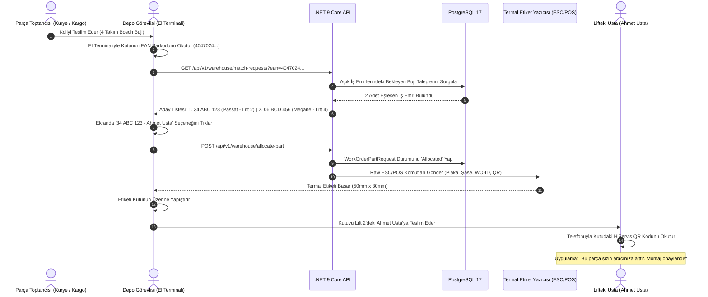

# Modül 3: Tedarik Zinciri & Mühürlü Parça İzlenebilirliği Şartnamesi

> **Modül Kodu:** MOD-03  
> **Durum:** Canlı Şartname (Active Specification) · Sürüm: v1.1  
> **Sorumlu:** Backend Ekibi (.NET 9) & Donanım/Depo Ekibi  
> **İlgili Referanslar:** [PROJE_ANAYASASI.md](../../PROJE_ANAYASASI.md) · [Donanım ve Termal Yazıcı Protokolü](../01-mimari-ve-altyapi/DONANIM_VE_TERMAL_YAZICI_PROTOKOLU.md) · [Mal Kabul Testi](../04-test-ve-rehberler/MAL_KABUL_VE_QR_BASIM_TESTI.md)

---

## 1. Modülün Amacı ve Değer Önerisi

Sanayi sitelerinde kârlılığı kemiren en büyük operasyonel kaçak **sahipsiz parçalar ve yanlış montajdır**:
* Bir toptancı kargo kolisi içinde 4 farklı araç için aynı bujiden 4 kutu gönderir.
* Kutuların üzerinde sadece genel üretici EAN barkodu yazar; hangi kutunun hangi araca ait olduğu yazmaz.
* Parçalar tezgaha yığılır; Ahmet Usta'nın aracı beklerken Mehmet Usta yanlışlıkla kutuyu alıp kendi aracına takar.
* Akşam fatura kesilirken araç sahibine yanlış parçanın parası yazılır veya parça depoda "kayıp" görünür.

**Modül 3'ün Çözümü (Kapalı Devre Mühürleme):**
1. **1:N Satınalma Şeması:** Bir satınalma siparişinde (PO) birden fazla iş emrinin parça talebi toplanabilir.
2. **Öncelikli İş Emri Havuzu:** Toptancı kutusundaki genel EAN barkod okutulduğu an sistem o parçayı bekleyen açık araçları aciliyet sırasıyla listeler.
3. **Anlık Termal QR Mühürleme:** Depocu kutuyu seçtiği anda Bluetooth/Ağ termal yazıcısından Plaka + Şase + İş Emri No içeren mühür etiketi basılır ve kutuya yapıştırılır. Etiketsiz parça depodan lifte çıkamaz.

---

## 2. Mal Kabul ve Parça Eşleştirme Akış Şeması



---

## 3. Veri Modeli ve Sözleşmeler

### 3.1 Satınalma ve Parça Talep İlişkisi (1:N ve N:M Bağlantısı)
* `PurchaseOrders` (PO Header): Tedarikçi adı, fatura tutarı, sipariş tarihi, teslimat durumu.
* `PurchaseOrderLines` (PO Satırları): Malzeme SKU, sipariş adedi, gelen adet, birim fiyat.
* `WorkOrderPartRequests`: Her iş emrinin parça ihtiyacı, `PoLineId` üzerinden ilgili PO satırına bağlanır.

```sql
-- Parça Tahsis İstek Modeli
POST /api/v1/warehouse/allocate-part
{
  "partRequestId": "a1b2c3d4-e5f6-7a8b-9c0d-123456789abc",
  "poLineId": "f9e8d7c6-b5a4-3210-fedc-ba9876543210",
  "scannedBarcode": "4047024185242",
  "targetWarehouseId": "c3b2a100-1111-2222-3333-444455556666", -- Maslak Şube Deposu
  "printLabelImmediately": true
}
```

### 3.2 Mühürlü Termal Etiket Formatı (50mm x 30mm)

```text
┌────────────────────────────────────────────────────────┐
│  HiServis AI                                MASLAK OTO │
│  İŞ EMRİ: #WO-2026-10492                               │
│  PLAKA: 34 ABC 123        USTA: Ahmet Usta (Lift 2)   │
│  ŞASE:  WVWZZZ3CZWE123456                              │
│  PARÇA: Bosch Fren Balatası (Ön Takım)                 │
│  ┌──────────┐                                          │
│  │ [QR KOD] │  MÜHÜR TOKENI: HS-WO10492-P01           │
│  │          │  TARİH: 18.11.2026 14:35                 │
│  └──────────┘                                          │
└────────────────────────────────────────────────────────┘
```

---

## 4. Tersine Lojistik: Uyumsuz Parça İade Akışı

Usta kutuyu açtığında parçanın araca uymadığını (örneğin disk çapının 288mm yerine 312mm geldiğini) fark ederse:

1. Teknisyen mobil uygulamasında parça satırındaki **"Uyumsuz Parça / İade"** butonuna basar.
2. Açılır listeden neden seçilir: `Boyut Uyumsuz`, `Hasarlı/Kırık`, `Katalog Hatası`, `Müşteri Vazgeçti`.
3. Sistem parçayı iş emrinden anında düşer (`Status = ReturnedToWarehouse`).
4. Parça depodaki `ReturnToSupplier (Tedarikçiye İade)` sanal rafına aktarılır.
5. Sistem danışmanın ekranına *"Yeni Parça Talebi Aç (#WO-10492 İçin)"* uyarısı verir.
6. Muhasebeye ise *"Tedarikçiden İade Faturası / Alacak Dekontu Bekleniyor"* finansal görevi atanır.

---

## 5. Kabul Kriterleri (Acceptance Criteria - Gherkin)

```gherkin
Özellik: Mühürlü Parça Eşleştirme ve Kapalı Devre Depo Yönetimi
  Senaryo: Ortak EAN barkodlu ürünün doğru iş emrine tahsis edilmesi
    Diyelim ki 34 ABC 123 plakalı araç için bekleyen 1 adet buji talebi var
    Ve toptancıdan gelen kolide bu bujiden 4 adet çıktı
    Depocu ilk kutuyu okuttuğunda
    Sistem 34 ABC 123 plakalı iş emrini öncelikli seçenek olarak göstermelidir
    Tahsis butonuna basıldığında
    Termal yazıcıdan 1 saniye içinde araç plakası ve iş emri QR kodunu içeren etiket çıkmalıdır
    Ve iş emrinin parça durumu "Depoda Hazır - Lifte Sevk Edildi" olarak güncellenmelidir.

  Senaryo: Yanlış parçanın montajının engellenmesi
    Diyelim ki Mehmet Usta sehven Ahmet Usta'nın aracı için mühürlenmiş kutuyu aldı
    Mehmet Usta kendi aracının mobil ekranında bu kutudaki QR kodu okuttuğunda
    Sistem kırmızı ekran vererek "UYARI: Bu parça 34 ABC 123 plakalı araca aittir, monte edilemez!" uyarısı vermelidir
    Ve montaj işlemini kilitlenmelidir.
```
