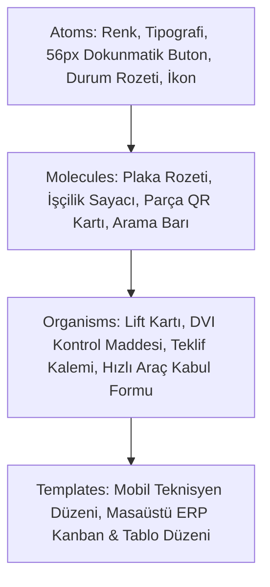

# HiServis AI — Modüler UI Bileşen Kataloğu ve Tasarım Sistemi Sözleşmesi (UI-Kit & Pattern Library)

> **Durum:** Canlı Tasarım ve Bileşen Sözleşmesi (Living Component Contract) · Sürüm: v1.1  
> **Sorumlu:** Kurucu Ortaklar (Lead Architect & CPO)  
> **Temel İlke:** "Sıfır Tasarım Kopukluğu (Zero Visual Drift)" — İlerleyen süreçte sisteme hangi modül eklenirse eklensin, bu anayasadaki atomik bileşenler ve durum matrisi dışına çıkılamaz.  
> **İlgili Referanslar:** [Tasarım Sistemi](TASARIM_SISTEMI_VE_MOBIL_ERGONOMI.md) · [Ekran Tel Çerçeveleri](../02-oto-servis-ve-operasyon/MOBIL_VE_WEB_EKRAN_TASARIMLARI.md) · [PROJE_ANAYASASI.md](../../PROJE_ANAYASASI.md)

---

## 1. Tasarım Sistemi Hiyerarşisi (Atomic Design Standardı)

Yeni bir modül (örneğin v2.0'da *Asansör Bakım* veya *Lastik Oteli*) geliştirilirken yeni görsel stiller icat edilemez. Tüm ekranlar aşağıdaki 4 seviyeli atomik hiyerarşiden türetilir:



---

## 2. Durum Makinesi Görsel Eşleme Matrisi (Status-to-Visual Contract)

Veritabanındaki her iş emri ve parça durumunun arayüzdeki renk, kenarlık, ikon ve animasyon kuralları sabittir:

| Veritabanı Statüsü | Türkçe UI Etiketi | Arka Plan & Kenarlık | Metin & İkon Rengi | Standart İkon (Lucide) | Nabız (Pulse) / Animasyon |
|---|---|---|---|---|---|
| `Open` | **Yeni Kabul / Açık** | Açık Mavi / Sky-100 (Koyu: Sky-950) | Sky-600 (`#0284C7`) | `Clock` | Yok |
| `InProgress` | **Lifte Alındı / İşlemde** | Canlı Mavi / Blue-100 (Koyu: Blue-950) | Blue-600 (`#2563EB`) | `Wrench` | Mavi Yavaş Nabız (İşçilik Sayacı Aktif) |
| `WaitingParts` | **Parça Bekleniyor** | Turuncu / Amber-100 (Koyu: Amber-950) | Amber-600 (`#D97706`) | `PackageSearch` | Parça depoya ulaştığında Yeşil Flaş |
| `CustomerApproval` | **Müşteri Onayı Bekliyor** | Mor / Purple-100 (Koyu: Purple-950) | Purple-600 (`#9333EA`) | `Send` | Müşteri linke baktığında "İnceliyor" etiketi |
| `Completed` | **Tamamlandı / Kalite Kontrol** | Zümrüt Yeşili / Emerald-100 (Koyu: Emerald-950) | Emerald-600 (`#059669`) | `CheckCircle2` | Tek seferlik yeşil onay animasyonu |
| `Invoiced` | **Faturalandı / Teslim Edildi** | Gri / Slate-100 (Koyu: Slate-900) | Slate-600 (`#475569`) | `FileCheck` | Yok (Statik Arşiv) |
| `Cancelled` | **İptal Edildi** | Koyu Kırmızı / Red-100 (Koyu: Red-950) | Red-600 (`#DC2626`) | `XCircle` | Yok |
| `QUARANTINE_REVIEW` | **Karantinada / İnceleme Gerekli** | Fosforlu Kırmızı / Rose-200 (Koyu: Rose-950) | Rose-700 (`#BE123C`) | `ShieldAlert` | **Hızlı Kırmızı Nabız (Dikkat Çekici)** |

---

## 3. Atomik Bileşen Şartnamesi (Atoms)

### 3.1. Dokunmatik Optimize Butonlar (Touch-First Buttons)
Sanayi sitesinde teknisyenin yağlı parmakları ve iş eldivenleri nedeniyle buton boyutları masaüstü standartlarından farklıdır:

```text
1. Primary Action Button (H: 56px, Radius: 12px, Font: 16px Bold)
   ┌────────────────────────────────────────────────────────┐
   │             📸  RUHSAT FOTOĞRAFI ÇEK                   │  [Bg: #2563EB, Text: #FFFFFF]
   └────────────────────────────────────────────────────────┘

2. Danger / Stop Button (H: 56px, Radius: 12px, Font: 16px Bold)
   ┌────────────────────────────────────────────────────────┐
   │             🛑  İŞÇİLİĞİ DURDUR & MOLA VER             │  [Bg: #DC2626, Text: #FFFFFF]
   └────────────────────────────────────────────────────────┘

3. Secondary / Ghost Button (H: 48px, Radius: 12px, Font: 15px Medium)
   ┌────────────────────────────────────────────────────────┐
   │             ➕  Manuel Kilometre Gir                    │  [Border: 1.5px #CBD5E1]
   └────────────────────────────────────────────────────────┘
```
* **Kural:** Mobilde birincil aksiyon butonlarının yüksekliği asla `48px` altına inemez (Önerilen: `56px`).
* **Haptik Tetikleyici:** Tüm birincil butonlara basıldığında mobil cihaz `HapticFeedback.mediumImpact()` titreşimi üretir.

---

### 3.2. Türkiye Standart Plaka ve Varlık Kimlik Rozeti (Plate & Asset Badge Component)
Uygulamanın neresinde bir varlık kimliği geçiyorsa (iş emri, fatura, parça kartı, lift/istasyon), sektöre uygun standart rozet kullanılır:

```text
A. Otomotiv (TR Plaka Rozeti):
┌────┬────────────────────────┐
│ TR │  34 ABC 123            │   [Mavi Sol Bant: #003399, Beyaz Zemin: #FFFFFF]
└────┴────────────────────────┘   [Yazı: DIN 1451 / FE-Schrift benzeri 18px Bold Siyah]
                                  [Kenarlık: 1.5px Kömür Grisi #1E293B, Radius: 6px]

B. Genel Sanayi / Asansör / Jeneratör (Endüstriyel Varlık Rozeti):
┌─────┬───────────────────────┐
│ AS  │  AS-2026-9901         │   [Mavi Sol Bant: #1E293B, Kırık Beyaz Zemin: #F8FAFC]
└─────┴───────────────────────┘   [Yazı: JetBrains Mono / Inter 16px Bold Koyu Gri]
```

---

### 3.3. Üç Kademeli DVI Denetim Çipi (Inspection Traffic-Light Chips)
Araç muayenesinde ustanın parmakla tek dokunuşta durum belirtmesini sağlayan 3 kademeli seçici:

```text
┌─────────────────┬─────────────────┬─────────────────┐
│  🟢  SORUNSUZ   │  🟡  TAKİP ET   │  🔴  ACİL DEĞİŞ │
└─────────────────┴─────────────────┴─────────────────┘
```
* **🟢 Sorunsuz (Pass):** Açık yeşil zemin, yeşil onay ikonu. Ekstra açıklama zorunlu değildir.
* **🟡 Takip Et (Future Attention):** Amber zemin. KM veya süre uyarısı girilebilir (Örn: "5.000 KM sonra kontrol").
* **🔴 Acil Değiş (Fail / Immediate Risk):** Kırmızı zemin. **Kural:** Bu seçenek işaretlendiğinde sistem otomatik olarak kamerayı açar ve en az 1 görsel kanıt fotoğrafı çekilmesini zorunlu kılar.

---

## 4. Moleküler Bileşen Şartnamesi (Molecules)

### 4.1. Mühürlü Parça QR Kartı (Sealed Part Component)
Depodan lifte giden her parçanın mobil ve web arayüzündeki standart kartı:

```text
┌────────────────────────────────────────────────────────────────────────┐
│  [📦] BOSCH ÖN FREN BALATASI                          HS-WO10492-P01  │
│  OEM: 5Q0 698 151 B  •  Tedarikçi: Başbuğ Oto        Durum: [ HAZIR ]  │
│  ────────────────────────────────────────────────────────────────────  │
│  Tahsis Edilen Araç: [TR | 34 ABC 123] (Passat B8 - Lift 1 / Ahmet U.) │
│  [ 📸 Parça Montaj Fotoğrafı Çek ]             [ ⚠️ Uyumsuz / İade ]   │
└────────────────────────────────────────────────────────────────────────┘
```

---

### 4.2. Sayısal Dokunmatik Giriş Padi (Full-Screen Numeric Keypad)
Sanayi ustasının işletim sisteminin minik sanal klavyesiyle boğuşmaması için, Kilometre veya Fiyat girilirken açılan özel dev Numpad:

```text
┌────────────────────────────────────────────────────────┐
│  GÜNCEL ARAÇ KİLOMETRESİ:                              │
│  [             145.200 KM                            ] │
├───────────────┬───────────────────────┬────────────────┤
│       1       │           2           │       3        │
├───────────────┼───────────────────────┼────────────────┤
│       4       │           5           │       6        │
├───────────────┼───────────────────────┼────────────────┤
│       7       │           8           │       9        │
├───────────────┼───────────────────────┼────────────────┤
│       C       │           0           │       ⌫        │
├───────────────┴───────────────────────┴────────────────┤
│  [                KİLOMETREYİ KAYDET                 ] │
└────────────────────────────────────────────────────────┘
```
*(Her tuş: Min 70px x 70px, dev puntolu rakamlar)*

---

## 5. Şablon ve Ekran Düzen Standartları (Layout Templates)

### 5.1. Mobil Teknisyen Ekran Düzeni (3 Bölmeli Sabit Şablon)
Tüm mobil teknisyen ekranları istisnasız şu 3 katmandan oluşur:

1. **Katman 1 (Üst - Sticky Header, H: 56px):**
   * Sol: Geri butonu veya Şube adı
   * Orta: Araç Plaka Rozeti ([TR | 34 ABC 123])
   * Sağ: Çevrimdışı/Çevrimiçi Senkronizasyon Rozeti (🟢 Bulut / 🔴 Çevrimdışı)
2. **Katman 2 (Orta - Scrollable Body):**
   * Yapılacak işler, DVI checklist maddeleri, fotoğraf galerisi veya parça listesi.
3. **Katman 3 (Alt - Sticky Action Footer, H: 72px):**
   * Teknisyenin başparmağının altına oturan sabit 1 ila 3 dev buton (Sesli Not, Fotoğraf, Tamamla). Asla kaybolmaz.

---

### 5.2. Masaüstü Ofis & Yönetim Paneli Düzeni (Fluid Responsive Grid)
Next.js 19 yönetim panelinde veri yoğunluğu için kullanılan standart:

1. **Sol Menü (Sidebar - 240px sabit / 64px daraltılabilir):**
   * Logo, Şube Değiştirici Açılır Menü, Lift Kanban, İş Emirleri, Parça/Depo, Müşteriler, Karantina (Rozetli), Ayarlar.
2. **Üst Bilgi Çubuğu (Top Bar - H: 64px):**
   * Global Hızlı Arama (Plaka, Şase, Müşteri Adı - Typo-tolerant Meilisearch)
   * Karantina Uyarı Sayacı (Kırmızı yanıp sönen alarm rozeti)
   * Aktif Kullanıcı ve Hızlı Şube Seçimi
3. **Çalışma Alanı (Main Canvas):**
   * 12 Sütunlu Grid sistemi (Tailwind `grid-cols-12`).

---

## 6. Boş Durumlar (Empty States) ve Çevrimdışı Bildirim Standartları

HiServis AI'da hiçbir ekran kullanıcıya boş beyaz sayfa gösteremez:

### 6.1. Boş Durum Kuralı (Empty State Pattern)
* İlgili istasyon veya listede veri yoksa:
  * Merkezde açıklayıcı vektörel ikon (Örn: Gri Lift veya Boş Parça Kutusu)
  * Net durum mesajı: *"Şu anda Lift 2'de üzerinde çalışılan araç bulunmuyor."*
  * Hızlı eylem butonu: `[ + Yeni Araç Kabulü Yap ]` veya `[ Başka Liftten Araç Aktar ]`.

### 6.2. Çevrimdışı Uyarı Bandı (Offline Sync Banner)
GSM veya Wi-Fi kesildiğinde ekranın en tepesinde kayan turuncu/kırmızı ince uyarı bandı açılır:
```text
┌────────────────────────────────────────────────────────────────────────┐
│ ⚡ ÇEVRİMDISI MOD: İşlemleriniz yerel belleğe kaydediliyor.           │
│    İnternet geldiğinde otomatik olarak buluta eşitlenecektir. (3 Olay) │
└────────────────────────────────────────────────────────────────────────┘
```

---

## 7. Yeni Modül Ekleme Kontrol Listesi (Design Checklist for Future Modules)

Gelecekte sisteme yeni bir modül (Örn: *Ekspertiz Raporu*, *Sigorta Kasko Entegrasyonu*, *Lastik Oteli*) ekleneceğinde tasarımcı ve geliştiricinin onaylaması gereken **5 Kural**:

- [ ] **Kural 1:** Yeni eklenen modüldeki tüm durumlar Madde 2'deki *Durum Makinesi Matrisi* renk jetonlarına uyuyor mu?
- [ ] **Kural 2:** Araç tanımlanan her yerde *Türkiye Standart Plaka Rozeti* kullanıldı mı?
- [ ] **Kural 3:** Mobil ekrandaki tüm tıklanabilir alanlar minimum 56x56 px yüksekliğe sahip mi?
- [ ] **Kural 4:** Sayısal veri girişlerinde sistem sanal klavyesi yerine *Sayısal Dokunmatik Giriş Padi* kullanıldı mı?
- [ ] **Kural 5:** Modül hem *Derin Koyu Mod (#0B0F19)* hem de *Yüksek Kontrastlı Açık Modda* görsel kırılma olmadan test edildi mi?
