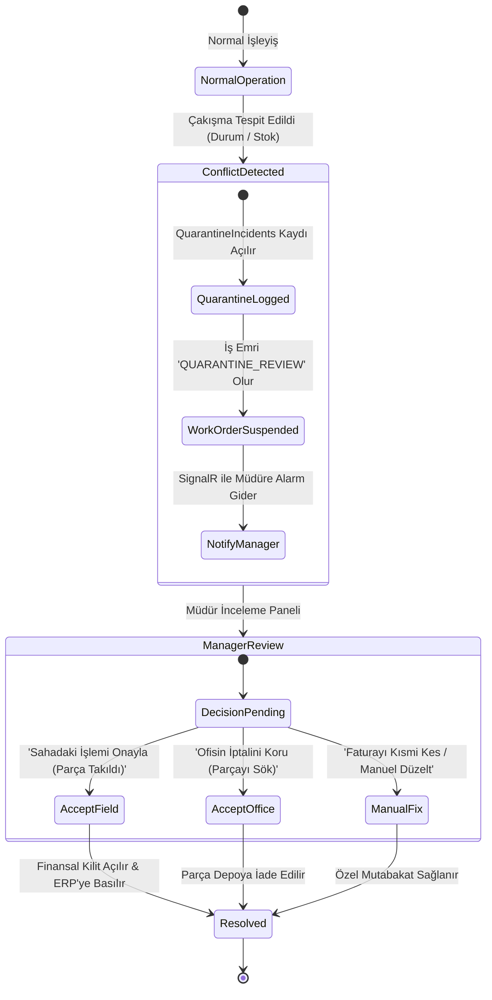

# HiServis AI — Çevrimdışı Çalışma ve Karantina Mimarisi (Offline & Quarantine)

> **Durum:** Canlı Mimari Sözleşme (Architecture Contract) · Sürüm: v1.1  
> **Sorumlu:** Lead Architect & Mobil Ekip Lideri  
> **İlgili Referanslar:** [PROJE_ANAYASASI.md](../../PROJE_ANAYASASI.md) · [Teknik Mimari](TEKNIK_MIMARI.md) · [Karantina Testi](../04-test-ve-rehberler/CEVRIMDISI_CALISMA_VE_KARANTINA_TESTI.md)

---

## 1. Mimari İlke: "Sessiz Ezme Yok, Şeffaf Karantina Var"

Geleneksel senkronizasyon algoritmalarında (örneğin saf CRDT veya Last-Write-Wins) zaman damgası daha yeni olan kayıt eskisini ezer. 

Ancak bir oto servisinde bu yaklaşım felakete yol açar:
* **Örnek:** Müşteri servisi arayıp *"Aracı almaya geliyorum, tamiri durdurun"* der. Ofis danışmanı iş emrini `Cancelled` yapar. O esnada internetsiz çukurda çalışan usta 3.500 TL'lik orijinal fren diskini takıp iş emrini mobilde `Completed` yapar ve ıslak imza alır.
* **Last-Write-Wins Mantığı:** Cihaz internete bağlandığında ofisin iptalini ustanın tamamlaması ezer veya tam tersi gerçekleşir. Parça muhasebede havada kalır; müşteri *"Ben iptal etmiştim"* der.

**HiServis AI Karantina İlkesi:**
Sistem Durum Makinesi çakışmalarında veya stok yetersizliğinde asla otomatik ezme yapmaz. İş emri durumu anında `QUARANTINE_REVIEW` durumuna çekilir ve Servis Müdürünün onayına sunulur.

---

## 2. Mobil Drift (SQLite) ve Çevrimdışı Çalışma Katmanı

Mobil cihazda çalışan Flutter uygulaması, doğrudan uzaktaki PostgreSQL'e bağlanmaz; tüm CRUD işlemlerini cihazın yerel flash belleğindeki **Drift SQLite** veritabanına yazar:

```text
[Mobil UI / Teknisyen Ekranı]
       │
       ▼
[Drift Reaktif SQLite Veritabanı] ──► (Sıfır Gecikme, 0ms Network Wait)
       │
       ▼
[Yerel Outbox Kuyruğu (LocalOutboxTable)]
       │
       ▼ (İnternet Geldiği Anda Arka Planda)
[Sync Background Service] ──► POST /api/v1/sync/batch (gRPC / HTTPS)
```

### Çevrimdışı İşlem Yetenekleri:
* ✅ Yeni iş emri açma ve plaka/ruhsat fotoğrafı kaydetme
* ✅ İş emrine depodan parça ekleme ve sarfiyat düşümü
* ✅ Teknisyen sesli notunu şifreli `.m4a` olarak kaydetme
* ✅ Müşteriden dijital teslimat imzası alma ve çevrimdışı PDF üretme

---

## 3. Hibrit Mantıksal Saat (Hybrid Logical Clock - HLC)

İstemci cihazların saatleri yanlış veya manipüle edilmiş olabilir (örneğin telefonun saati 2024'e ayarlanmış olabilir). Dağıtık ortamda deterministik sıralama yapabilmek için her olaya **HLC Zaman Damgası** verilir:

$$HLC = (PhysicalTime, LogicalCounter)$$

* Sunucuya gelen her mutasyon, istemcinin ve sunucunun en yüksek gördüğü fiziksel saat ve sayaç kombinasyonu ile damgalanır.
* Böylece hangi işlemin kesin olarak diğerinden sonra yapıldığı matematiksel olarak kanıtlanır.

---

## 4. Karantina Olayı Yaşam Döngüsü (Quarantine Lifecycle)



---

## 5. Karantina Çözümleme Arayüzü ve Hakemlik Yetkileri

Karantinaya düşen bir olay için Servis Müdürünün web panelinde açılan **Hakemlik Kartı** şu 3 seçeneği sunar:

1. **Sahayı Onayla (Accept Field):** Teknisyenin taktığı parçayı onaylar, ofisteki iptal işlemini *"Fiziksel Müdahale Nedeniyle İptal Kaldırıldı"* olarak günceller ve faturayı müşterinin borcuna işler.
2. **Ofisi Onayla (Accept Office):** İptali kesinleştirir. Teknisyenin ekranına *"DİKKAT: Parça araçtan derhal sökülüp depoya teslim edilmelidir"* acil iş görevi gönderir.
3. **Manuel Düzenle (Manual Fix):** Parçanın maliyetini iskonto eder veya servis içi garanti/masraf kalemine aktarır.

---

## 6. Sınır Durumlar ve Ağ Kesintisi Kurtarma

* **Uygulama Kapanması / Telefonun Şarjının Bitmesi:** Drift SQLite `WAL (Write-Ahead Logging)` moduyla çalışır; telefon aniden kapansa dahi yarım kalan SQL transaksiyonu geri alınır, veri bozulması (corruption) yaşanmaz.
* **Haftalarca İnternete Bağlanmayan Mobil Cihaz:** Cihaz 7 günden uzun süre senkronize olmamışsa, güvenlik gereği doğrudan arka plan senkronizasyonu durdurulur ve kullanıcıdan *"Merkezle Tam Eşitleme Yap"* onay butonu istenir.
