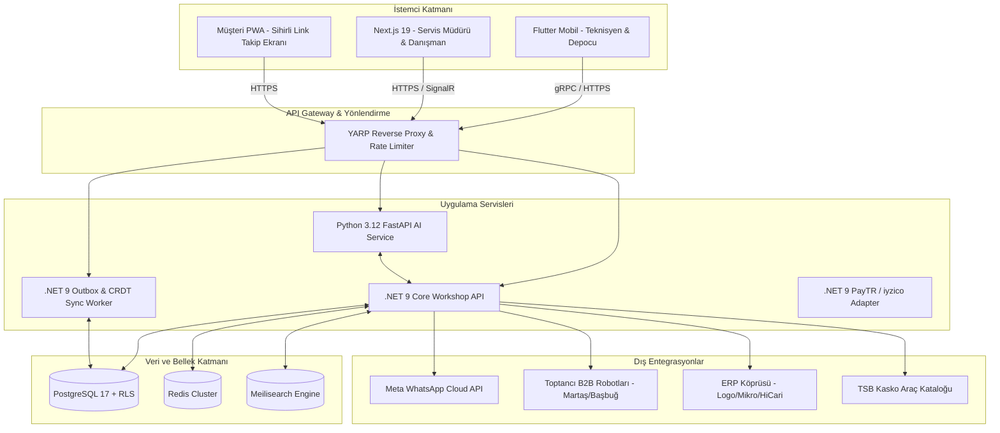

# HiServis AI — Teknik Mimari ve Sistem Omurgası

> **Durum:** Canlı Mimari Sözleşme (Architecture Contract) · Sürüm: v1.1  
> **Sorumlu:** Lead Architect  
> **İlgili Referanslar:** [PROJE_ANAYASASI.md](../../PROJE_ANAYASASI.md) · [Veritabanı ve RLS](VERITABANI_SEMASI_VE_RLS_KURALLARI.md) · [Çevrimdışı ve Karantina](CEVRIMDISI_VE_KARANTINA_MIMARISI.md)

Bu doküman; HiServis AI platformunun katmanlı mimarisini, teknoloji seçimlerini, güvenlik modelini ve mikroservis/modüler monolit sınırlarını belirler.

---

## 1. Teknoloji Yığını (Technology Stack)

| Katman | Seçilen Teknoloji | Seçim Gerekçesi |
|---|---|---|
| **Çekirdek Backend API** | **.NET 9 (C#)** | Yüksek verim, asenkron G/Ç performansı, Minimal APIs, yerel AOT derleme desteği ve güçlü kurumsal tip güvenliği. |
| **Mobil İstemci (Saha/Usta)** | **Flutter (Dart)** | iOS ve Android'de tek kod tabanı, donanım kamera/Bluetooth erişimi, yerel Drift SQLite ile gerçek Offline-First desteği. |
| **Web İstemcisi (Ofis/Yönetim)** | **Next.js 19 / React (TypeScript)** | Server-Side Rendering (SSR), Tailwind CSS, Shadcn/UI, TanStack Query & Table ile yüksek veri yoğunluklu ERP arayüzleri. |
| **İlişkisel Veritabanı** | **PostgreSQL 17** | Row-Level Security (RLS), JSONB indeksleme, gelişmiş transaksiyonel Outbox desteği. |
| **Çevrimdışı Yerel Veritabanı** | **Drift (SQLite)** | Flutter üzerinde reaktif, tip güvenli yerel veritabanı; zayıf GSM ortamında sıfır gecikmeli veri okuma/yazma. |
| **Yapay Zeka & Konuşma Servisi** | **Python 3.12 (FastAPI)** | Whisper-large-v3, LangGraph orkestrasyonu, ONNX Runtime ve ses işleme ekosistemine doğrudan erişim. |
| **Önbellek & Gerçek Zamanlı Mesajlaşma** | **Redis Cluster & SignalR** | Dağıtık oturum yönetimi, kuyruk kilitleme (Redlock) ve anlık servis paneli güncellemeleri. |
| **Hızlı Arama Motoru** | **Meilisearch** | Yüz binlerce parça kodu (SKU), OEM numarası ve müşteri plakasında milisaniyelik typo-tolerant (yazım hatasına dayanıklı) arama. |

---

## 2. Katmanlı Sistem Mimarisi Topolojisi



---

## 3. Çok Kiracılı ve Çok Şubeli Güvenlik Modeli (RLS)

Sistemde kiracılar (Tenants) ve şubeler (Branches) mantıksal olarak aynı PostgreSQL veritabanında izole edilir:

1. **Oturum Bağlamı:** Her API isteğinde JWT çözülür; veritabanı bağlantısı açıldığında oturum değişkenleri atanır:
   ```sql
   SET LOCAL app.current_tenant_id = 'e5b8c3a1-7d24-4f9e-bc8e-123456789abc';
   SET LOCAL app.current_branch_id = 'a1b2c3d4-1111-2222-3333-444455556666';
   ```
2. **PostgreSQL RLS Politikası:**
   ```sql
   ALTER TABLE WorkOrders ENABLE ROW LEVEL SECURITY;
   
   CREATE POLICY workorder_isolation_policy ON WorkOrders
   FOR ALL
   USING (
       TenantId = current_setting('app.current_tenant_id')::uuid
       AND (
           BranchId = current_setting('app.current_branch_id')::uuid
           OR current_setting('app.is_tenant_admin', true) = 'true'
       )
   );
   ```
3. **Sıfır Veri Sızıntısı Garantisi:** Yazılım kodunda `WHERE TenantId = ...` filtresi unutulsa dahi, PostgreSQL motoru kiracı veya şube dışı sorgularda fiziksel olarak boş sonuç döner.

---

## 4. İletişim Protokolleri ve API Standartları

* **İç İletişim (Sync & Donanım):** Mobil çevrimdışı senkronizasyonda veri sıkıştırma ve hız için Protobuf / gRPC tercih edilir.
* **Dış API (Web & Mobil):** RESTful JSON API (OpenAPI 3.1 / Swagger sözleşmesi ile dokümante edilir).
* **Gerçek Zamanlı İletişim:** Lift durumu, parça depoya ulaştı bildirimi ve karantina alarmları için **SignalR Hub** kullanılır.
* **Dayanıklı Olay Mesajlaşması (Transactional Outbox):** Veritabanına yazılan her iş emri durumu, aynı SQL transaksiyonunda `OutboxEvents` tablosuna da yazılır. Arka plan işleyicisi (Background Worker) bu olayları işleyerek dış sistemlere iletir; ağ kopsa dahi mesaj kaybı yaşanmaz.
